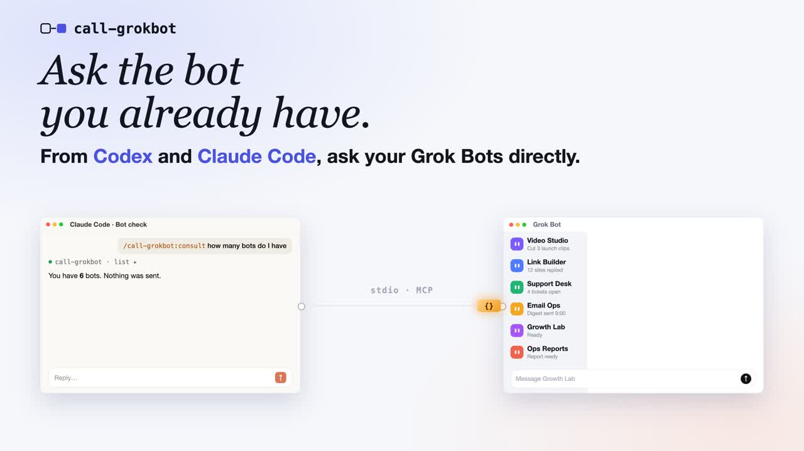
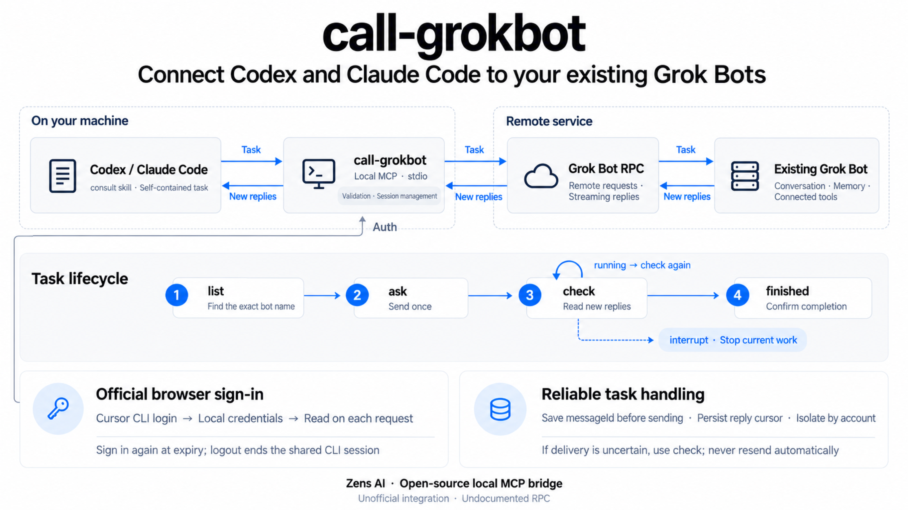

# call-grokbot

Consulta tus **Grok Bots** existentes desde **Codex** y **Claude Code**. Un servidor MCP local por stdio envía una tarea con todo el contexto necesario, lee las respuestas de forma incremental y permite interrumpir el trabajo de un bot contactado. El bot conserva su conversación, memoria y herramientas conectadas.

**Proyecto no oficial, sin afiliación, respaldo ni soporte de Cursor / Anysphere, xAI / Grok, OpenAI o Anthropic.** El RPC de Grok Bot no tiene una especificación pública y puede cambiar. Este proyecto no proporciona un endpoint público de inferencia de modelos.

[English](README.md) · [日本語](README.ja.md) · [Español](README.es.md) · [Português (Brasil)](README.pt-BR.md) · [简体中文](README.zh-CN.md) · [繁體中文](README.zh-TW.md)

[Detalles de autenticación (en inglés)](docs/authentication.md)

## Vídeo de demostración

[](https://youtu.be/d0C7Hjs3z3w)

Haz clic en la imagen para ver la demostración de 50 segundos en YouTube (narración en inglés).

## Cómo funciona



## Antes de empezar

- Instala Node.js **22.13 o posterior**, npm y Git.
- Instala **Codex** o **Claude Code** e inicia sesión en el cliente que vayas a usar. Esa cuenta es independiente del inicio de sesión de Cursor descrito más adelante.
- Instala por separado la [CLI oficial de Cursor](https://cursor.com/docs/cli/installation).
- Necesitas una cuenta con acceso a Grok Bot y al menos un bot ya creado. Usa el nombre exacto que aparece en la aplicación; esta herramienta no crea bots.

Elige la guía del plugin de Codex o de Claude Code. Ambos incluyen la skill `consult` e inician el servidor MCP mediante `npx` con una versión fija. No necesitas instalar `call-grokbot` globalmente, clonar el código, tener una cuenta de npm ni solicitar una clave API personal.

En macOS se leen las credenciales de la CLI oficial guardadas en el Llavero; en Linux y Windows, su archivo de autenticación. No copies tokens a la configuración MCP. El flujo con una cuenta real se ha probado en macOS. Linux y Windows tienen cobertura de CI, pero no se ha verificado el inicio de sesión con cuentas reales.

El **plugin 0.1.2** utiliza el **paquete ejecutable de npm 0.1.1**. Sus comandos fijan la URL del tarball oficial de npm para evitar que se ejecute por error el código local de un proyecto con el mismo nombre. Esto resuelve `command not found` y `CONNECTION_CLOSED` dentro de este repositorio y funciona también con la caché vacía. No requiere una instalación global.

## Configurar el plugin en Codex

### 1. Instala el plugin desde tu terminal

```sh
codex plugin marketplace add ZensHQ/call-grokbot --ref plugin-v0.1.2
codex plugin add call-grokbot@call-grokbot
codex plugin list
```

Comprueba que `call-grokbot@call-grokbot` esté instalado y habilitado. Son comandos de terminal. Si tu versión de Codex no reconoce `plugin`, actualízala a una que admita plugins. Consulta la [documentación oficial de plugins de Codex](https://developers.openai.com/plugins/build/plugins#add-a-marketplace-from-the-cli).

### 2. Inicia sesión en la cuenta del bot desde tu terminal

```sh
npx --yes https://registry.npmjs.org/call-grokbot/-/call-grokbot-0.1.1.tgz login
npx --yes https://registry.npmjs.org/call-grokbot/-/call-grokbot-0.1.1.tgz doctor
```

`login` ejecuta `agent login` de la CLI oficial de Cursor. En el navegador, elige la cuenta a la que pertenece el bot y completa las comprobaciones de seguridad necesarias. `doctor` debe mostrar `"authenticated": true`, `"authMode": "browser"` y `"cursorCliFound": true`, sin revelar credenciales.

### 3. Abre una sesión nueva de Codex y llama a la skill

Inicia Codex desde el proyecto en el que quieras trabajar:

```sh
codex
```

Escribe lo siguiente **en la conversación de Codex**, no en la terminal:

```text
$call-grokbot:consult Muestra mis bots existentes. No envíes ningún mensaje.
```

Elige un nombre exacto de la lista. Sustituye `Research Bot` por el nombre real de tu bot:

```text
$call-grokbot:consult Pide a mi bot existente "Research Bot" que responda exactamente PONG.
Envía la tarea una sola vez. Si sigue en running, usa check hasta que llegue a finished; no la reenvíes.
```

Esta petición envía un mensaje real a la conversación existente del bot. Comprueba que recibes `PONG` y que la tarea llega a `finished`: un acuse de recibo inicial no basta. Para una tarea real, sustituye la prueba por instrucciones que incluyan los datos relevantes, las restricciones, las acciones permitidas y el resultado esperado.

## Configurar el plugin en Claude Code

### 1. Instala el plugin desde tu terminal

```sh
claude plugin marketplace add ZensHQ/call-grokbot
claude plugin install call-grokbot@call-grokbot --scope user
claude plugin list
```

Comprueba que `call-grokbot@call-grokbot` esté habilitado. El ámbito `user` lo hace disponible en tus proyectos de Claude Code de esta máquina. Si ya estás dentro de Claude Code, también puedes usar estos comandos interactivos:

```text
/plugin marketplace add ZensHQ/call-grokbot
/plugin install call-grokbot@call-grokbot
```

En el panel de instalación, elige **Install for you (ámbito user)**. La [documentación oficial de Claude Code](https://code.claude.com/docs/es/discover-plugins) explica los demás ámbitos.

### 2. Inicia sesión en la cuenta del bot desde tu terminal

```sh
npx --yes https://registry.npmjs.org/call-grokbot/-/call-grokbot-0.1.1.tgz login
npx --yes https://registry.npmjs.org/call-grokbot/-/call-grokbot-0.1.1.tgz doctor
```

Completa el inicio de sesión oficial de Cursor en el navegador con la cuenta propietaria del bot. Verifica `"authenticated": true`, `"authMode": "browser"` y `"cursorCliFound": true` en el resultado de `doctor`. Si ya iniciaste sesión para el plugin de Codex en esta máquina, ambos comparten esa sesión de la CLI oficial: basta con ejecutar el comando `doctor` anterior, sin volver a iniciar sesión.

### 3. Comprueba la conexión y abre una sesión nueva de Claude Code

En tu terminal:

```sh
claude mcp list
claude
```

La comprobación debe mostrar `plugin:call-grokbot:call-grokbot` como conectado. Espera a que el servidor termine de conectarse antes de enviar la primera petición. Si tenías una sesión abierta antes de instalar el plugin, abre otra para que cargue el plugin y la skill.

Escribe esto **en la conversación de Claude Code**:

```text
/call-grokbot:consult Muestra mis bots existentes. No envíes ningún mensaje.
```

Sustituye `Research Bot` por un nombre exacto de la lista:

```text
/call-grokbot:consult Pide a mi bot existente "Research Bot" que responda exactamente PONG.
Envía la tarea una sola vez. Si sigue en running, usa check hasta que llegue a finished; no la reenvíes.
```

También se envía un mensaje real. Verifica tanto `PONG` como `finished`. Para el trabajo habitual, incluye el contenido necesario en la petición: el bot no ve automáticamente tu conversación de Claude Code ni los archivos locales del proyecto.

## Solución de problemas de instalación

| Síntoma | Qué hacer |
| --- | --- |
| `call-grokbot: command not found` | El plugin no instala un ejecutable global. Ejecuta `login` o `doctor` con los comandos `npx` y la URL oficial del tarball indicados arriba. |
| `command not found` o `CONNECTION_CLOSED` dentro del código fuente de call-grokbot | Actualiza al plugin 0.1.2 y utiliza su URL fija del tarball. Corregir un comando de terminal no cambia la configuración del plugin instalado. La solución anterior con `--global` puede fallar con una caché vacía. |
| `CLI_MISSING` | Instala la CLI oficial de Cursor desde el enlace anterior. Si está en otra ubicación, establece `CALL_GROKBOT_CURSOR_CLI` con la ruta absoluta del ejecutable. |
| `AUTH_REQUIRED` o `AUTH_EXPIRED` | Repite el comando de inicio de sesión con la versión fija, completa el proceso en el navegador y ejecuta `doctor`. El servidor MCP no abre el navegador al iniciarse. |
| No aparecen la skill o las herramientas MCP | Comprueba la instalación y habilitación con `codex plugin list` o `claude plugin list` y abre una sesión nueva. Una instalación solo MCP no incluye la skill. |
| Claude Code indica que las herramientas no están disponibles o que sigue conectando | Espera al arranque de MCP y consulta `claude mcp list`. Si ya está conectado pero la sesión sigue sin herramientas, abre otra sesión. No reenvíes una tarea que quizá ya se haya enviado. |
| Falta un bot o se devuelve 403 | Verifica el nombre exacto y la cuenta del navegador. Una sesión válida no garantiza acceso al RPC no documentado; consulta las limitaciones más abajo. |

## Actualizar un plugin ya instalado

Un marketplace de Codex fijado a una etiqueta anterior no cambia automáticamente a otra. Para pasar a esta versión del plugin, ejecuta en tu terminal:

```sh
codex plugin remove call-grokbot@call-grokbot
codex plugin marketplace remove call-grokbot
codex plugin marketplace add ZensHQ/call-grokbot --ref plugin-v0.1.2
codex plugin add call-grokbot@call-grokbot
```

Para una instalación de Claude Code con ámbito user:

```sh
claude plugin marketplace update call-grokbot
claude plugin update call-grokbot@call-grokbot --scope user
```

Abre una sesión nueva después de actualizar. La sesión de la CLI oficial de Cursor es independiente del plugin y no requiere otro inicio de sesión mientras siga siendo válida.

## Opcional: configurar solo MCP

Usa esta opción en lugar del plugin si solo necesitas las cuatro herramientas MCP. No instales ambos métodos en el mismo cliente, porque aparecerán herramientas duplicadas. Este método no incluye `consult`; pide al asistente que use las herramientas de call-grokbot mediante una petición normal.

Primero completa la misma comprobación de inicio de sesión en tu terminal:

```sh
npx --yes https://registry.npmjs.org/call-grokbot/-/call-grokbot-0.1.1.tgz login
npx --yes https://registry.npmjs.org/call-grokbot/-/call-grokbot-0.1.1.tgz doctor
```

Registra el servidor de Codex:

```sh
codex mcp add call-grokbot -- npx --yes https://registry.npmjs.org/call-grokbot/-/call-grokbot-0.1.1.tgz
```

Si necesitas una lista de bots permitidos o tiempos de espera más largos, configura la misma entrada en `~/.codex/config.toml`:

```toml
[mcp_servers.call-grokbot]
command = "npx"
args = ["--yes", "https://registry.npmjs.org/call-grokbot/-/call-grokbot-0.1.1.tgz"]
startup_timeout_sec = 30
tool_timeout_sec = 660
env = { CALL_GROKBOT_AGENTS = "Research Bot" }
```

Registra el servidor de Claude Code:

```sh
claude mcp add --transport stdio --scope user call-grokbot -- npx --yes https://registry.npmjs.org/call-grokbot/-/call-grokbot-0.1.1.tgz
```

También puedes usar este `.mcp.json` en un proyecto de confianza en lugar de la entrada de ámbito user:

```json
{
  "mcpServers": {
    "call-grokbot": {
      "command": "npx",
      "args": ["--yes", "https://registry.npmjs.org/call-grokbot/-/call-grokbot-0.1.1.tgz"],
      "env": {
        "CALL_GROKBOT_AUTH_MODE": "browser",
        "CALL_GROKBOT_AGENTS": "Research Bot"
      }
    }
  }
}
```

Cambia `Research Bot` por el nombre exacto de un bot existente. Abre una sesión nueva tras modificar la configuración MCP.

## Opcional: instalación global o desde el código fuente

Para disponer de un comando global, ejecuta `npm install --global call-grokbot@0.1.1`. Después podrás usar directamente `call-grokbot login`, `call-grokbot doctor` y los demás subcomandos en lugar de la forma fija con `npx`.

Para ejecutar desde el código fuente:

```sh
git clone https://github.com/ZensHQ/call-grokbot.git
cd call-grokbot
npm ci
npm run build
node dist/cli.js login
node dist/cli.js doctor
```

Desde otros directorios usa `node /absolute/path/to/call-grokbot/dist/cli.js`. En la configuración MCP JSON/TOML, establece `command` en `node` y `args` en `["/absolute/path/to/call-grokbot/dist/cli.js"]`.

## Las cuatro herramientas

| Herramienta | Función |
| --- | --- |
| `list()` | Lista los bots existentes visibles para la cuenta, la lista de permitidos configurada y los contactos locales. No envía mensajes. |
| `ask({agent, message, wait_seconds})` | Envía una sola vez a un bot existente con nombre exacto. Rechaza nombres inexistentes o ambiguos; no crea bots. |
| `check({agent, wait_seconds})` | Lee respuestas pendientes y espera una tarea existente. Nunca reenvía el mensaje. |
| `interrupt({agent})` | Detiene el turno actual de un bot contactado. Puede incluir trabajo iniciado en la aplicación; no deshace acciones ya completadas. |

Solo puedes omitir `agent` si la lista de permitidos contiene un único bot. `wait_seconds` vale **45** por defecto y acepta **0–600**; cero devuelve una instantánea inicial sin esperar. El resultado contiene `status: "running" | "finished"` y, opcionalmente, `reply`. Si está en `running`, llama a `check`, sin repetir `ask`. `finished` requiere pruebas del estado real y de la finalización del turno, no solo una primera confirmación. Un turno interrumpido puede finalizar sin respuesta.

`earlierReplies` en un resultado de `ask` contiene mensajes anteriores aún no leídos; sepáralos de la respuesta a la tarea nueva. `check` avanza el cursor local y no vuelve a devolver respuestas ya consumidas. Los cursores se conservan como cadenas decimales, incluso fuera del rango de enteros seguros de JavaScript. Los pasos internos de las herramientas no se devuelven como respuestas.

Ejemplo de petición:

> Pide a Research Bot que compare las dos propuestas de despliegue pegadas aquí. Incluye las mediciones de latencia y el presupuesto de esta conversación. Solicita tres puntos a favor y en contra, y una recomendación. Solo investigación; no hagas cambios.

## Caducidad, renovación y cierre de sesión

```sh
npx --yes https://registry.npmjs.org/call-grokbot/-/call-grokbot-0.1.1.tgz auth status
npx --yes https://registry.npmjs.org/call-grokbot/-/call-grokbot-0.1.1.tgz auth refresh
npx --yes https://registry.npmjs.org/call-grokbot/-/call-grokbot-0.1.1.tgz logout
```

El modo predeterminado es `browser`, aunque exista `CURSOR_API_KEY` en el entorno. Si el navegador está en otro equipo, ejecuta el inicio de sesión con `NO_OPEN_BROWSER=1` para que la CLI oficial muestre su URL.

`auth refresh` repite el inicio de sesión oficial en el navegador. La sesión de la CLI instalada tiene una duración fija; la observada en las pruebas fue de unos 60 días. Su campo `refreshToken` no constituye un mecanismo de renovación silenciosa verificado. El proyecto no inventa endpoints OAuth de renovación ni promete una autenticación de navegador indefinida y desatendida.

Cada petición autenticada vuelve a leer las credenciales oficiales más recientes. Tras iniciar sesión de nuevo, no es necesario reiniciar MCP. Las credenciales caducadas, revocadas o ausentes detienen la herramienta y generan una indicación para iniciar sesión. `doctor` informa de la caducidad sin mostrar tokens; ask/check también avisan en los cinco minutos previos.

**Cerrar sesión afecta a la sesión compartida de la CLI oficial de Cursor.** Los demás programas que la usen también tendrán que autenticarse de nuevo. Se conservan los contactos locales para reanudar la lectura desde el cursor de cada cuenta. Cerrar sesión no detiene el trabajo en la nube ni deshace acciones completadas.

Para ejecución desatendida puedes seleccionar explícitamente `CALL_GROKBOT_AUTH_MODE=api-key`. Lee, por orden, `CALL_GROKBOT_API_KEY`, `CURSOR_API_KEY`, un `CURSOR_API_KEY_FILE` especificado y `CURSOR_SERVICE_ACCOUNT_KEY`. Intercambia la clave por una sesión de corta duración, agrupa intercambios concurrentes y renueva antes de la caducidad. Solo reintenta una lectura autenticada una vez cuando obtiene un token nuevo. La clave personal probada tenía **Sign in to the Cursor CLI and SDK** y **Run agents**, pero no se ha determinado el conjunto mínimo de permisos. Tampoco se ha verificado el acceso de cuentas de servicio a bots personales. El paquete no guarda claves.

## Configuración

| Variable | Valor predeterminado | Significado |
| --- | --- | --- |
| `CALL_GROKBOT_AUTH_MODE` | `browser` | `browser` o selección explícita de `api-key` |
| `CALL_GROKBOT_CURSOR_CLI` | Detección automática | Ruta absoluta del ejecutable oficial `agent` |
| `CALL_GROKBOT_AGENTS` | Todos los bots existentes | Nombres separados por comas, o un array JSON de nombres u objetos `{name,description}` |
| `CALL_GROKBOT_DEFAULT_WAIT_SECONDS` | `45` | Espera predeterminada, limitada por el máximo |
| `CALL_GROKBOT_MAX_WAIT_SECONDS` | `600` | Tiempo máximo de espera permitido |
| `CALL_GROKBOT_REQUEST_TIMEOUT_MS` | `20000` | Tiempo límite por petición HTTP unaria |
| `CALL_GROKBOT_SETTLE_MS` | `1500` | Intervalo sin actividad tras confirmar la finalización |
| `CALL_GROKBOT_DISABLED_TOOLS` | Vacío | Nombres de herramientas que se omiten, separados por comas |
| `CALL_GROKBOT_STATE_DIR` | Directorio de estado del sistema | Contactos locales y bloqueos entre procesos |
| `CALL_GROKBOT_API_BASE_URL` | `https://api2.cursor.sh` | Origen oficial o servidor de prueba en loopback; se rechazan otros hosts |

El estado se guarda por defecto en `$XDG_STATE_HOME/call-grokbot` o `~/.local/state/call-grokbot`; en Windows, en `%LOCALAPPDATA%/call-grokbot`. Solo contiene identificadores de bots, cursores, marcas de tiempo y registros de mensajes pendientes de confirmar. Se separa por sujeto autenticado y origen. En POSIX, los archivos usan 0600 y los directorios 0700; en Windows se aplica la ACL del perfil de usuario. No se guardan tokens, claves, texto de las conversaciones ni cookies del navegador.

## Recuperación y limitaciones

- **Envío sin confirmar:** el ID del mensaje se guarda antes de enviarlo. Usa `check` para revisar la entrega y las respuestas. Los mensajes y las interrupciones no se reintentan automáticamente, ni siquiera ante tiempos de espera agotados o HTTP 5xx. No reenvíes a ciegas.
- **Cancelación o error del flujo:** se conserva el cursor de mensajes no leídos. Si se envió un mensaje, su registro pendiente permanece y `check` permite continuar.
- **Tarea pendiente:** se rechaza un segundo `ask` hasta que `check` confirme la finalización. Los bloqueos por bot también impiden que varios clientes locales intercalen envíos.
- **Estado dañado o historial reiniciado:** la herramienta se detiene de forma segura. Haz una copia de `state.json` y revisa la conversación real antes de resolver el contacto afectado.
- **Permiso 403:** una sesión válida no garantiza acceso a este RPC no documentado. No se cambia de cuenta ni se crean bots ni se amplían permisos automáticamente.

Las herramientas actúan sobre conversaciones reales de la cuenta. El bot no ve el contexto del IDE a menos que lo incluyas en la petición; el código y el texto incluidos salen de tu equipo hacia el servicio. Sus respuestas pueden contener material externo no fiable. La lista de permitidos limita este cliente, no los permisos de la cuenta autenticada. No se usan puertos de depuración del navegador, extracción de cookies guardadas, servidores HTTP/SSE a la escucha, mecanismos para eludir aprobaciones ni un proxy de la suscripción al modelo Grok.

## Desarrollo y pruebas

```sh
npm ci
npm run check
npm test
npm run typecheck
npm run test:plugins
npm pack --dry-run
```

`test:plugins` crea una caché de npm nueva y anónima, descarga el paquete público fijado y prueba ambos plugins desde el código fuente, otro proyecto y un directorio de prueba con el mismo nombre y versión. Comprueba el descubrimiento de las cuatro herramientas sin autenticarse ni enviar mensajes. Requiere acceso a la red y también se ejecuta en CI.

Las pruebas cubren cambios de credenciales, caducidad y cierre de sesión, renovación concurrente de claves API, aislamiento entre cuentas, cursores grandes, tramas Connect fragmentadas, reintentos de lectura sin reintentos de escritura, recuperación de envíos pendientes, cancelación, escritura de estado entre procesos, interrupciones durante un ask en espera y descubrimiento, esquemas y llamadas MCP.

Prueba opcional con un bot existente dedicado:

```sh
CALL_GROKBOT_LIVE_AGENT="Your Test Bot" npm run test:live
```

Sustituye `Your Test Bot` por su nombre exacto. La prueba envía un PONG real, comprueba la lectura incremental y la finalización, e invoca interrupt después de terminar. Nunca modifica el perfil del bot. Los resultados de pruebas reales se excluyen de Git y no contienen credenciales. Consulta los límites en las [notas de verificación (en inglés)](docs/verification.md).

Por [Zens AI](https://zens.ai). Licencia MIT. Consulta [NOTICE.md (en inglés)](NOTICE.md) para obtener información sobre la implementación independiente y sus referencias.
