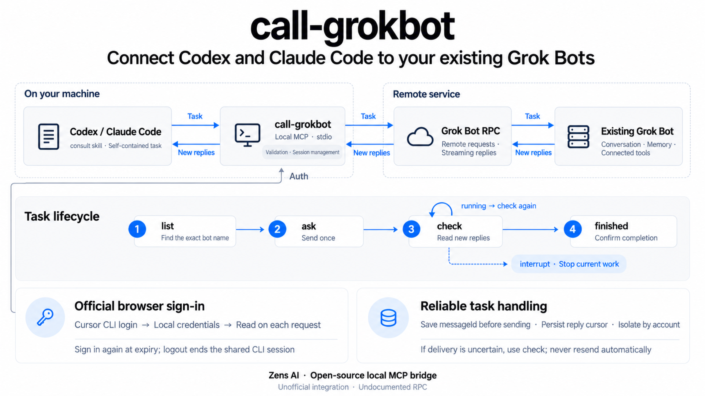

# call-grokbot

Ask your existing **Grok Bots** from **Codex** and **Claude Code**. A local
stdio MCP server sends one self-contained task, reads incremental replies, and
can interrupt a contacted bot. Your bot keeps its existing conversation,
memory, and connected tools.

**Unofficial. Not affiliated with, endorsed by, or supported by Cursor /
Anysphere, xAI / Grok, OpenAI, or Anthropic.** The Grok Bot RPC is undocumented
and may change. No public model-inference endpoint is provided.

[English](README.md) · [日本語](README.ja.md) · [Español](README.es.md) · [Português (Brasil)](README.pt-BR.md) · [简体中文](README.zh-CN.md) · [繁體中文](README.zh-TW.md)

[Authentication details](docs/authentication.md)

## Watch the demo

https://github.com/user-attachments/assets/d89194ec-7d43-44d2-9116-a3007e1f2c22

A 50-second walkthrough with English narration.

## How it works



## Before you start

- Install Node.js **22.13+**, npm, and Git.
- Install and sign in to the client you want to use: **Codex** or **Claude Code**.
  Your coding client's account is separate from the Cursor login below.
- Install the [official Cursor CLI](https://cursor.com/docs/cli/installation).
- Have a Grok Bot account and at least one existing bot. Use the exact bot name
  shown in your app; this package does not create bots.

Choose the plugin guide for [Codex](#codex-plugin-quickstart) or
[Claude Code](#claude-code-plugin-quickstart). Both plugins include the
`consult` skill and start the MCP server with a pinned `npx` package. You do
not need a global `call-grokbot` install, a source checkout, an npm account,
or a personal API key.

macOS browser authentication uses the official CLI's login Keychain entries.
Linux and Windows use the official CLI's auth file. Do not copy tokens into
MCP configuration. Real-account plugin tests passed on macOS; Linux and
Windows have CI coverage, but their real-account login flows have not been
verified.

Plugin release **0.1.2** uses npm runtime **0.1.1**. Its `npx` commands
pin the official npm tarball URL, so npm cannot substitute the current
same-name source checkout. This fixes `command not found` and MCP
`CONNECTION_CLOSED` inside this repository and also works with an empty cache.
No global package installation is required.

## Codex plugin quickstart

### 1. Install the plugin in your terminal

```sh
codex plugin marketplace add ZensHQ/call-grokbot --ref plugin-v0.1.2
codex plugin add call-grokbot@call-grokbot
codex plugin list
```

Confirm that `call-grokbot@call-grokbot` is installed and enabled. These are
terminal commands. If your Codex installation does not recognize `plugin`,
update to a version that supports plugin commands. See the
[official Codex plugin documentation](https://developers.openai.com/plugins/build/plugins#add-a-marketplace-from-the-cli).

### 2. Sign in to the bot account in your terminal

```sh
npx --yes https://registry.npmjs.org/call-grokbot/-/call-grokbot-0.1.1.tgz login
npx --yes https://registry.npmjs.org/call-grokbot/-/call-grokbot-0.1.1.tgz doctor
```

`login` runs the official Cursor CLI's `agent login`. In the browser, select
the account that owns your bot and complete any security check. `doctor`
should report `"authenticated": true`, `"authMode": "browser"`, and
`"cursorCliFound": true`, without printing credentials.

### 3. Open a new Codex session and call the skill

Start Codex from the project you want to work in:

```sh
codex
```

Type this **in the Codex conversation**, not in your terminal:

```text
$call-grokbot:consult List my existing bots. Do not send any message.
```

Choose an exact name from the result. In the example below, replace
`Research Bot` with your bot's actual name:

```text
$call-grokbot:consult Ask my existing bot "Research Bot" to reply exactly PONG.
Send the task once. If it is running, use check until it finishes; do not resend.
```

This sends a real message to that bot's existing conversation. A successful
check means you received `PONG` **and** the task reached `finished`; an initial
acknowledgement is not enough. For a real task, replace the PONG request with
one self-contained brief containing the relevant facts, constraints, allowed
actions, and desired output.

## Claude Code plugin quickstart

### 1. Install the plugin in your terminal

```sh
claude plugin marketplace add ZensHQ/call-grokbot
claude plugin install call-grokbot@call-grokbot --scope user
claude plugin list
```

Confirm that `call-grokbot@call-grokbot` is enabled. User scope makes it
available to your Claude Code projects on this machine. If you are already
inside Claude Code, the interactive equivalents are:

```text
/plugin marketplace add ZensHQ/call-grokbot
/plugin install call-grokbot@call-grokbot
```

In the interactive install panel, choose **Install for you** (user scope).
See the [official Claude Code plugin documentation](https://code.claude.com/docs/en/discover-plugins)
for other installation scopes.

### 2. Sign in to the bot account in your terminal

```sh
npx --yes https://registry.npmjs.org/call-grokbot/-/call-grokbot-0.1.1.tgz login
npx --yes https://registry.npmjs.org/call-grokbot/-/call-grokbot-0.1.1.tgz doctor
```

Complete the official Cursor CLI browser sign-in with the account that owns
your bot. Confirm `"authenticated": true`, `"authMode": "browser"`, and
`"cursorCliFound": true` in the doctor result. If you already signed in for
the Codex plugin on this machine, both plugins share that official CLI
session; run `npx --yes https://registry.npmjs.org/call-grokbot/-/call-grokbot-0.1.1.tgz doctor` to check it instead of
signing in again.

### 3. Check the connection, then open a new Claude Code session

In your terminal:

```sh
claude mcp list
claude
```

The health check should show `plugin:call-grokbot:call-grokbot` as connected.
Allow the server to finish connecting before your first request. If a session
was open before installation, start a new one so it loads the plugin and skill.

Type this **in the Claude Code conversation**:

```text
/call-grokbot:consult List my existing bots. Do not send any message.
```

Replace `Research Bot` below with an exact existing name from the result:

```text
/call-grokbot:consult Ask my existing bot "Research Bot" to reply exactly PONG.
Send the task once. If it is running, use check until it finishes; do not resend.
```

This is a real message in your bot's conversation. Verify both `PONG` and
`finished`. For normal work, provide the relevant content in the brief: the
bot cannot automatically see your Claude Code session or project files.

## Setup troubleshooting

| Symptom | What to do |
| --- | --- |
| `call-grokbot: command not found` | Plugin installs do not add a global executable. Use `npx --yes https://registry.npmjs.org/call-grokbot/-/call-grokbot-0.1.1.tgz login` or `npx --yes https://registry.npmjs.org/call-grokbot/-/call-grokbot-0.1.1.tgz doctor` in your terminal. |
| `command not found` or `CONNECTION_CLOSED` inside the call-grokbot source checkout | Use plugin 0.1.2 and its pinned npm tarball URL. Adding a fix to a terminal command alone does not update an already installed plugin. The older `--global` workaround can fail with an empty npm cache. |
| `CLI_MISSING` | Install the official Cursor CLI linked above. For a nonstandard location, set `CALL_GROKBOT_CURSOR_CLI` to its absolute executable path. |
| `AUTH_REQUIRED` or `AUTH_EXPIRED` | Run the pinned `npx` login command again, finish browser sign-in, and run `npx --yes https://registry.npmjs.org/call-grokbot/-/call-grokbot-0.1.1.tgz doctor`. MCP startup does not open a browser for you. |
| The skill or MCP tools are missing | Confirm the plugin is installed and enabled with `codex plugin list` or `claude plugin list`, then start a new client session. An MCP-only install does not include the skill. |
| Claude Code says the tools are unavailable or the server is still connecting | Wait for MCP startup and check `claude mcp list`. If the session still has no tools, open a new session after the health check reports connected. Do not resend a task that may already have been sent. |
| A bot is missing or a request returns 403 | Confirm the exact bot name and the browser account you signed in to. A valid login does not guarantee access to the undocumented bot RPC; see [Recovery and boundaries](#recovery-and-boundaries). |

## Update an existing plugin installation

A Codex marketplace pinned to an earlier tag stays on that tag. To move it to
this plugin release, run these commands in your terminal:

```sh
codex plugin remove call-grokbot@call-grokbot
codex plugin marketplace remove call-grokbot
codex plugin marketplace add ZensHQ/call-grokbot --ref plugin-v0.1.2
codex plugin add call-grokbot@call-grokbot
```

For the Claude Code user-scope installation:

```sh
claude plugin marketplace update call-grokbot
claude plugin update call-grokbot@call-grokbot --scope user
```

Start a new client session after updating. Your official Cursor CLI login is
shared independently of the plugin and does not need to be repeated while valid.

## Optional: direct MCP configuration

Use this instead of the plugin when you only need the four MCP tools. Do not
install both paths in the same client, or you will get duplicate tools. This
path does not include `consult`; ask the coding assistant to use the
call-grokbot tools in an ordinary prompt.

First complete the same terminal login and doctor check:

```sh
npx --yes https://registry.npmjs.org/call-grokbot/-/call-grokbot-0.1.1.tgz login
npx --yes https://registry.npmjs.org/call-grokbot/-/call-grokbot-0.1.1.tgz doctor
```

For Codex, register the server from your terminal:

```sh
codex mcp add call-grokbot -- npx --yes https://registry.npmjs.org/call-grokbot/-/call-grokbot-0.1.1.tgz
```

For a bot allowlist and longer tasks, configure the same entry in
`~/.codex/config.toml`:

```toml
[mcp_servers.call-grokbot]
command = "npx"
args = ["--yes", "https://registry.npmjs.org/call-grokbot/-/call-grokbot-0.1.1.tgz"]
startup_timeout_sec = 30
tool_timeout_sec = 660
env = { CALL_GROKBOT_AGENTS = "Research Bot" }
```

For Claude Code, register the server from your terminal:

```sh
claude mcp add --transport stdio --scope user call-grokbot -- npx --yes https://registry.npmjs.org/call-grokbot/-/call-grokbot-0.1.1.tgz
```

Or use this `.mcp.json` in a trusted project instead of the user-scope entry:

```json
{
  "mcpServers": {
    "call-grokbot": {
      "command": "npx",
      "args": ["--yes", "https://registry.npmjs.org/call-grokbot/-/call-grokbot-0.1.1.tgz"],
      "env": {
        "CALL_GROKBOT_AUTH_MODE": "browser",
        "CALL_GROKBOT_AGENTS": "Research Bot"
      }
    }
  }
}
```

Replace `Research Bot` with an exact existing name. Open a new client session
after changing MCP configuration.

## Optional: global or source installation

For a global command, install `npm install --global call-grokbot@0.1.1`.
You can then use `call-grokbot login`, `doctor`, and the other subcommands
directly instead of the pinned `npx` form.

To run from source:

```sh
git clone https://github.com/ZensHQ/call-grokbot.git
cd call-grokbot
npm ci
npm run build
node dist/cli.js login
node dist/cli.js doctor
```

Use `node /absolute/path/to/call-grokbot/dist/cli.js` for source commands.
For JSON/TOML MCP configuration, set `command` to `node` and `args` to
`["/absolute/path/to/call-grokbot/dist/cli.js"]`.

## Four tools

| Tool | Purpose |
| --- | --- |
| `list()` | List existing bots visible to the account, the optional allowlist, and local contacts. Sends no message. |
| `ask({agent, message, wait_seconds})` | Send once to an exact existing bot. A nonexistent or ambiguous name is refused; **no bot is created**. |
| `check({agent, wait_seconds})` | Read unread replies and wait for an existing task. Never resends a message. |
| `interrupt({agent})` | Stop a contacted bot's current turn. It may include work started in the app; completed actions are not undone. |

`agent` may be omitted only when the allowlist contains one bot.
`wait_seconds` defaults to **45**, accepts **0–600**, and returns an initial
snapshot at zero. A result contains `status: "running" | "finished"` and an
optional `reply`. `running` means call `check`; do not repeat `ask`.
`finished` requires the live bot state and turn completion evidence, not just
the first acknowledgement. An interrupted turn may finish without a reply.

An `ask` result may include `earlierReplies` from prior unread messages; keep
them separate from the answer to the new task. `check` advances the local
cursor, so a second check does not repeat already consumed replies. Cursor
values remain decimal strings, including values beyond JavaScript's safe integer
range. Internal tool steps are not returned as replies.

Example prompt:

> Ask Research Bot to compare the two attached deployment approaches. Include
> the latency measurements and budget constraints from this conversation.
> Request three tradeoffs and one recommendation. Research only; make no changes.

## Authentication expiry and logout

```sh
npx --yes https://registry.npmjs.org/call-grokbot/-/call-grokbot-0.1.1.tgz auth status
npx --yes https://registry.npmjs.org/call-grokbot/-/call-grokbot-0.1.1.tgz auth refresh
npx --yes https://registry.npmjs.org/call-grokbot/-/call-grokbot-0.1.1.tgz logout
```

Default authentication is `browser`, even when `CURSOR_API_KEY` is set.
If the browser is on another computer, run login with `NO_OPEN_BROWSER=1`
to have the official CLI print its login URL.

`auth refresh` opens another **official browser sign-in**. The
installed official CLI's browser session has a fixed lifetime (the session
observed in testing was about 60 days); its `refreshToken` field is **not** a
verified silent-refresh mechanism. This project does not invent an OAuth
refresh endpoint or promise endless unattended browser authentication.

Each authenticated request reads the latest official credentials. A successful
re-login is picked up without restarting the MCP server. Expired, revoked or
missing credentials stop the tool and tell you to sign in again. `doctor`
reports expiry without displaying tokens; ask/check also warn within five
minutes of browser-session expiry. **Logout signs out the shared
official Cursor CLI session**; other programs using that login must also sign
in again. Local contacts remain, so account-specific read cursors can resume.
Logout does not stop cloud bot work or undo completed actions.

An optional explicit `CALL_GROKBOT_AUTH_MODE=api-key` mode supports unattended
short-token renewal. It reads `CALL_GROKBOT_API_KEY`, `CURSOR_API_KEY`, an explicit
`CURSOR_API_KEY_FILE`, then `CURSOR_SERVICE_ACCOUNT_KEY`. It exchanges the key
for a short-lived session, shares concurrent exchanges, renews before expiry,
and retries an authenticated **read** once when a new token is obtained.
The tested personal key had both **Sign in to the Cursor CLI and SDK** and
**Run agents** enabled; the minimal grant set is not established. Service-account
access to personal bots is not verified. No key is stored by this package.

## Configuration

| Variable | Default | Meaning |
| --- | --- | --- |
| `CALL_GROKBOT_AUTH_MODE` | `browser` | `browser` or explicit `api-key` |
| `CALL_GROKBOT_CURSOR_CLI` | auto-detect | Absolute path to the official `agent` executable |
| `CALL_GROKBOT_AGENTS` | all existing bots | Comma-separated names, or a JSON array of names / `{name,description}` objects |
| `CALL_GROKBOT_DEFAULT_WAIT_SECONDS` | `45` | Default tool wait, capped by the maximum |
| `CALL_GROKBOT_MAX_WAIT_SECONDS` | `600` | Maximum allowed tool wait |
| `CALL_GROKBOT_REQUEST_TIMEOUT_MS` | `20000` | Timeout per unary HTTP request |
| `CALL_GROKBOT_SETTLE_MS` | `1500` | Quiet interval after confirmed completion |
| `CALL_GROKBOT_DISABLED_TOOLS` | empty | Comma-separated tool names to omit |
| `CALL_GROKBOT_STATE_DIR` | OS state directory | Local contacts and cross-process locks |
| `CALL_GROKBOT_API_BASE_URL` | `https://api2.cursor.sh` | Official origin or a loopback test server; other hosts are refused |

Default state is `$XDG_STATE_HOME/call-grokbot` or
`~/.local/state/call-grokbot`, and `%LOCALAPPDATA%/call-grokbot` on Windows.
State contains only bot identifiers, cursors, timestamps, and pending message
receipts. It is partitioned by the authenticated subject and origin. POSIX
files use 0600 and directories 0700; Windows access follows the user profile ACL.
Raw tokens, keys, conversation text, and browser cookies are never saved here.

## Recovery and boundaries

- **Unconfirmed send:** the message ID is saved before dispatch. Use `check` to
  inspect delivery and replies. Messages and interrupts are never retried
  automatically, even after timeouts or HTTP 5xx. Do not resend blindly.
- **Cancellation / stream error:** the unread cursor is preserved. If a message
  was sent, its pending receipt survives and `check` can resume it.
- **Pending task:** a second `ask` is refused until `check` observes completion.
  Per-bot file locks also prevent two local clients interleaving sends.
- **Corrupt state or transcript reset:** fail closed. Back up `state.json` and
  resolve the affected contact only after checking the real conversation.
- **Permission 403:** a valid login does not guarantee access to this undocumented
  RPC. No alternate account, bot creation or permission expansion is attempted.

These tools operate on the account's real bot conversations. A bot cannot see
your IDE context unless you include it; included code and text leave your
machine for the service. Bot replies may contain untrusted external material.
An allowlist limits this client, **not** the account permissions of the login.
No browser debugging port, saved browser-cookie extraction, HTTP/SSE listener,
approval bypass, or Grok model subscription proxy is used.

## Development and tests

```sh
npm ci
npm run check
npm test
npm run typecheck
npm run test:plugins
npm pack --dry-run
```

`test:plugins` uses a fresh anonymous npm cache, downloads the pinned public
runtime, and checks both plugin
launchers from this source checkout, an unrelated project, and a same-name /
same-version fixture. It discovers all four tools without authenticating or
sending bot messages. It requires network access and is also run in CI.

Tests cover credential rotation, expiry/logout, API-key renewal concurrency,
account isolation, large cursors, fragmented Connect frames, read retries,
non-retried writes, pending-send recovery, cancellation, cross-process state
writes, interrupts during a waiting ask, and MCP discovery / schemas / calls.

For an opt-in real test against a dedicated existing bot:

```sh
CALL_GROKBOT_LIVE_AGENT="Your Test Bot" npm run test:live
```

It sends a real PONG message, verifies incremental read and confirmed completion,
and invokes interrupt after completion. It never modifies a bot profile. Live
artifacts are gitignored and contain no credentials. See
[verification notes](docs/verification.md) for the exact tested boundaries.

By [Zens AI](https://zens.ai). MIT. See [NOTICE.md](NOTICE.md) for independent implementation and references.
