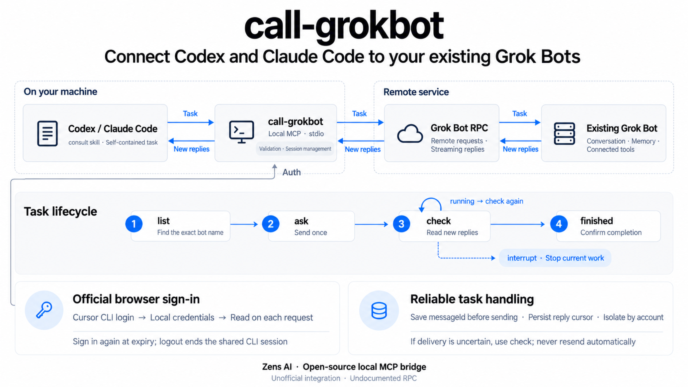

# call-grokbot

Consulte seus **Grok Bots** existentes pelo **Codex** e pelo **Claude Code**. Um servidor MCP local via stdio envia uma tarefa com todo o contexto necessário, lê as respostas de forma incremental e permite interromper o trabalho de um bot contatado. O bot mantém a conversa, a memória e as ferramentas já conectadas.

**Projeto não oficial, sem vínculo, endosso ou suporte de Cursor / Anysphere, xAI / Grok, OpenAI ou Anthropic.** O RPC do Grok Bot não tem especificação pública e pode mudar. Este projeto não fornece um endpoint público de inferência de modelos.

[English](README.md) · [日本語](README.ja.md) · [Español](README.es.md) · [Português (Brasil)](README.pt-BR.md) · [简体中文](README.zh-CN.md) · [繁體中文](README.zh-TW.md)

[Detalhes de autenticação (em inglês)](docs/authentication.md)

## Vídeo de demonstração

https://github.com/user-attachments/assets/d89194ec-7d43-44d2-9116-a3007e1f2c22

Demonstração de 50 segundos com narração em inglês.

## Como funciona



## Antes de começar

- Instale Node.js **22.13 ou superior**, npm e Git.
- Instale **Codex** ou **Claude Code** e entre na conta do cliente que pretende usar. Essa conta é independente do login do Cursor descrito abaixo.
- Instale separadamente a [CLI oficial do Cursor](https://cursor.com/docs/cli/installation).
- Tenha uma conta com acesso ao Grok Bot e pelo menos um bot já criado. Use o nome exato exibido no aplicativo; esta ferramenta não cria bots.

Escolha o guia do plugin para Codex ou Claude Code. Ambos incluem a skill `consult` e iniciam o servidor MCP pelo `npx`, com uma versão fixa do pacote. Não é necessário instalar `call-grokbot` globalmente, clonar o código, ter uma conta no npm ou solicitar uma chave de API pessoal.

No macOS, a autenticação lê os itens de login da CLI oficial no Acesso às Chaves (Keychain); no Linux e no Windows, lê o arquivo de autenticação da CLI. Não copie tokens para a configuração MCP. O fluxo com conta real foi validado no macOS. Linux e Windows têm cobertura de CI, mas o login com contas reais ainda não foi verificado.

O **plugin 0.1.2** usa o **pacote executável do npm 0.1.1**. Os comandos fixam a URL do tarball oficial do npm para evitar que o código local de um projeto com o mesmo nome seja usado por engano. Isso corrige `command not found` e `CONNECTION_CLOSED` dentro deste repositório e também funciona com o cache vazio. Não exige instalação global.

## Configurar o plugin no Codex

### 1. Instale o plugin pelo terminal

```sh
codex plugin marketplace add ZensHQ/call-grokbot --ref plugin-v0.1.2
codex plugin add call-grokbot@call-grokbot
codex plugin list
```

Confirme que `call-grokbot@call-grokbot` está instalado e habilitado. Esses comandos são executados no terminal. Se sua instalação do Codex não reconhecer `plugin`, atualize para uma versão com suporte a plugins. Consulte a [documentação oficial de plugins do Codex](https://developers.openai.com/plugins/build/plugins#add-a-marketplace-from-the-cli).

### 2. Entre na conta do bot pelo terminal

```sh
npx --yes https://registry.npmjs.org/call-grokbot/-/call-grokbot-0.1.1.tgz login
npx --yes https://registry.npmjs.org/call-grokbot/-/call-grokbot-0.1.1.tgz doctor
```

`login` executa o `agent login` da CLI oficial do Cursor. No navegador, selecione a conta à qual o bot pertence e conclua as verificações de segurança solicitadas. O resultado de `doctor` deve conter `"authenticated": true`, `"authMode": "browser"` e `"cursorCliFound": true`, sem exibir credenciais.

### 3. Abra uma nova sessão do Codex e chame a skill

Inicie o Codex no diretório do projeto em que deseja trabalhar:

```sh
codex
```

Digite o texto abaixo **na conversa do Codex**, não no terminal:

```text
$call-grokbot:consult Liste meus bots existentes. Não envie nenhuma mensagem.
```

Escolha um nome exato na lista. Substitua `Research Bot` pelo nome real do seu bot:

```text
$call-grokbot:consult Peça ao meu bot existente "Research Bot" que responda exatamente PONG.
Envie a tarefa uma única vez. Se continuar em running, use check até chegar a finished; não reenvie.
```

Isso envia uma mensagem real à conversa existente do bot. Confirme que recebeu `PONG` e que a tarefa chegou a `finished`; uma confirmação inicial de recebimento não basta. Para uma tarefa real, substitua o teste por uma descrição com os dados relevantes, as restrições, as ações permitidas e o resultado esperado.

## Configurar o plugin no Claude Code

### 1. Instale o plugin pelo terminal

```sh
claude plugin marketplace add ZensHQ/call-grokbot
claude plugin install call-grokbot@call-grokbot --scope user
claude plugin list
```

Confirme que `call-grokbot@call-grokbot` está habilitado. O escopo `user` disponibiliza o plugin nos seus projetos do Claude Code nesta máquina. Se já estiver dentro do Claude Code, também pode usar os comandos interativos:

```text
/plugin marketplace add ZensHQ/call-grokbot
/plugin install call-grokbot@call-grokbot
```

No painel de instalação, escolha **Install for you (escopo user)**. A [documentação oficial do Claude Code](https://code.claude.com/docs/pt/discover-plugins) explica os demais escopos.

### 2. Entre na conta do bot pelo terminal

```sh
npx --yes https://registry.npmjs.org/call-grokbot/-/call-grokbot-0.1.1.tgz login
npx --yes https://registry.npmjs.org/call-grokbot/-/call-grokbot-0.1.1.tgz doctor
```

Conclua o login oficial do Cursor no navegador usando a conta proprietária do bot. Verifique `"authenticated": true`, `"authMode": "browser"` e `"cursorCliFound": true` no resultado de `doctor`. Se já entrou para usar o plugin do Codex nesta máquina, os dois plugins compartilham a mesma sessão da CLI oficial. Basta executar o comando `doctor` acima para conferir, sem fazer login novamente.

### 3. Verifique a conexão e abra uma nova sessão do Claude Code

No terminal:

```sh
claude mcp list
claude
```

A verificação deve mostrar `plugin:call-grokbot:call-grokbot` como conectado. Aguarde a conexão do servidor antes da primeira solicitação. Se uma sessão já estava aberta antes da instalação, abra outra para carregar o plugin e a skill.

Digite isto **na conversa do Claude Code**:

```text
/call-grokbot:consult Liste meus bots existentes. Não envie nenhuma mensagem.
```

Substitua `Research Bot` pelo nome exato de um bot da lista:

```text
/call-grokbot:consult Peça ao meu bot existente "Research Bot" que responda exatamente PONG.
Envie a tarefa uma única vez. Se continuar em running, use check até chegar a finished; não reenvie.
```

Essa solicitação também envia uma mensagem real. Confirme tanto `PONG` quanto `finished`. No uso diário, inclua o conteúdo necessário na tarefa: o bot não vê automaticamente sua conversa do Claude Code nem os arquivos locais do projeto.

## Solução de problemas de instalação

| Sintoma | Como resolver |
| --- | --- |
| `call-grokbot: command not found` | O plugin não instala um executável global. Execute `login` ou `doctor` usando os comandos `npx` com a URL oficial do tarball mostrados acima. |
| `command not found` ou `CONNECTION_CLOSED` no código-fonte de call-grokbot | Atualize para o plugin 0.1.2 e use a URL fixa do tarball. Corrigir apenas o comando do terminal não atualiza a configuração do plugin instalado. A solução anterior com `--global` pode falhar com o cache vazio. |
| `CLI_MISSING` | Instale a CLI oficial do Cursor pelo link acima. Se estiver em um local diferente, defina `CALL_GROKBOT_CURSOR_CLI` com o caminho absoluto do executável. |
| `AUTH_REQUIRED` ou `AUTH_EXPIRED` | Execute novamente o login com a versão fixa, conclua a etapa no navegador e rode `doctor`. O servidor MCP não abre o navegador ao iniciar. |
| A skill ou as ferramentas MCP não aparecem | Confira a instalação e a habilitação com `codex plugin list` ou `claude plugin list` e abra uma nova sessão. A configuração apenas de MCP não inclui a skill. |
| Claude Code informa que as ferramentas estão indisponíveis ou ainda conectando | Aguarde a inicialização do MCP e confira `claude mcp list`. Se o servidor estiver conectado, mas a sessão continuar sem as ferramentas, abra outra. Não reenvie uma tarefa que possa já ter sido enviada. |
| Um bot não aparece ou a chamada retorna 403 | Confira o nome exato do bot e a conta usada no navegador. Um login válido não garante acesso ao RPC não documentado; consulte os limites abaixo. |

## Atualizar um plugin já instalado

Um marketplace do Codex fixado em uma tag anterior não muda automaticamente para outra. Para usar esta versão do plugin, execute no terminal:

```sh
codex plugin remove call-grokbot@call-grokbot
codex plugin marketplace remove call-grokbot
codex plugin marketplace add ZensHQ/call-grokbot --ref plugin-v0.1.2
codex plugin add call-grokbot@call-grokbot
```

Para uma instalação do Claude Code no escopo user:

```sh
claude plugin marketplace update call-grokbot
claude plugin update call-grokbot@call-grokbot --scope user
```

Abra uma nova sessão após atualizar. O login da CLI oficial do Cursor é independente do plugin e não precisa ser repetido enquanto estiver válido.

## Opcional: configurar apenas o MCP

Use este método no lugar do plugin se precisar apenas das quatro ferramentas MCP. Não instale os dois no mesmo cliente, pois as ferramentas ficarão duplicadas. Esse método não inclui `consult`; peça ao assistente para usar as ferramentas de call-grokbot com uma solicitação em linguagem natural.

Primeiro, faça a mesma verificação de login no terminal:

```sh
npx --yes https://registry.npmjs.org/call-grokbot/-/call-grokbot-0.1.1.tgz login
npx --yes https://registry.npmjs.org/call-grokbot/-/call-grokbot-0.1.1.tgz doctor
```

Registre o servidor no Codex:

```sh
codex mcp add call-grokbot -- npx --yes https://registry.npmjs.org/call-grokbot/-/call-grokbot-0.1.1.tgz
```

Para definir os bots permitidos e tempos de espera maiores, configure a mesma entrada em `~/.codex/config.toml`:

```toml
[mcp_servers.call-grokbot]
command = "npx"
args = ["--yes", "https://registry.npmjs.org/call-grokbot/-/call-grokbot-0.1.1.tgz"]
startup_timeout_sec = 30
tool_timeout_sec = 660
env = { CALL_GROKBOT_AGENTS = "Research Bot" }
```

Registre o servidor no Claude Code:

```sh
claude mcp add --transport stdio --scope user call-grokbot -- npx --yes https://registry.npmjs.org/call-grokbot/-/call-grokbot-0.1.1.tgz
```

Também é possível usar este `.mcp.json` em um projeto confiável, no lugar da configuração no escopo user:

```json
{
  "mcpServers": {
    "call-grokbot": {
      "command": "npx",
      "args": ["--yes", "https://registry.npmjs.org/call-grokbot/-/call-grokbot-0.1.1.tgz"],
      "env": {
        "CALL_GROKBOT_AUTH_MODE": "browser",
        "CALL_GROKBOT_AGENTS": "Research Bot"
      }
    }
  }
}
```

Troque `Research Bot` pelo nome exato de um bot existente. Abra uma nova sessão depois de alterar a configuração MCP.

## Opcional: instalação global ou a partir do código-fonte

Para disponibilizar um comando global, execute `npm install --global call-grokbot@0.1.1`. Depois, use diretamente `call-grokbot login`, `call-grokbot doctor` e os demais subcomandos no lugar da forma com `npx` e URL fixa.

Para executar a partir do código-fonte:

```sh
git clone https://github.com/ZensHQ/call-grokbot.git
cd call-grokbot
npm ci
npm run build
node dist/cli.js login
node dist/cli.js doctor
```

Em outros diretórios, use `node /absolute/path/to/call-grokbot/dist/cli.js`. Na configuração MCP em JSON/TOML, defina `command` como `node` e `args` como `["/absolute/path/to/call-grokbot/dist/cli.js"]`.

## As quatro ferramentas

| Ferramenta | Função |
| --- | --- |
| `list()` | Lista os bots existentes visíveis para a conta, os bots permitidos na configuração e os contatos locais. Não envia mensagens. |
| `ask({agent, message, wait_seconds})` | Envia uma única vez a um bot existente com nome exato. Recusa nomes inexistentes ou ambíguos; não cria bots. |
| `check({agent, wait_seconds})` | Lê respostas ainda não consumidas e aguarda uma tarefa existente. Nunca reenvia a mensagem. |
| `interrupt({agent})` | Interrompe o turno atual de um bot contatado. Pode incluir trabalho iniciado no aplicativo; ações já concluídas não são desfeitas. |

Só é possível omitir `agent` quando a lista de permitidos contém exatamente um bot. O padrão de `wait_seconds` é **45**, com valores de **0 a 600**; zero retorna uma visão inicial sem aguardar. O resultado inclui `status: "running" | "finished"` e, opcionalmente, `reply`. Quando estiver em `running`, chame `check`, sem repetir `ask`. O estado `finished` exige evidências do estado real e da conclusão do turno, não apenas a primeira confirmação. Um turno interrompido pode terminar sem resposta.

Um resultado de `ask` pode incluir `earlierReplies`, com respostas antigas ainda não lidas. Separe-as da resposta à nova tarefa. `check` avança o cursor local, evitando repetir respostas já consumidas. Os cursores permanecem como strings decimais, inclusive acima do limite de inteiros seguros do JavaScript. Etapas internas das ferramentas não são retornadas como respostas.

Exemplo de solicitação:

> Peça ao Research Bot que compare as duas propostas de implantação coladas aqui. Inclua as medições de latência e o orçamento desta conversa. Peça três pontos de prós e contras e uma recomendação. Apenas pesquise; não faça alterações.

## Expiração, renovação e logout

```sh
npx --yes https://registry.npmjs.org/call-grokbot/-/call-grokbot-0.1.1.tgz auth status
npx --yes https://registry.npmjs.org/call-grokbot/-/call-grokbot-0.1.1.tgz auth refresh
npx --yes https://registry.npmjs.org/call-grokbot/-/call-grokbot-0.1.1.tgz logout
```

O modo padrão é `browser`, mesmo que `CURSOR_API_KEY` esteja definido no ambiente. Se o navegador estiver em outro computador, use `NO_OPEN_BROWSER=1` no login para que a CLI oficial mostre a URL.

`auth refresh` repete o login oficial no navegador. A sessão da CLI instalada tem duração fixa; nos testes, foi de cerca de 60 dias. O campo `refreshToken` não representa um mecanismo de renovação silenciosa já verificado. O projeto não inventa um endpoint OAuth de renovação nem promete manter a autenticação do navegador indefinidamente sem interação.

Cada solicitação autenticada relê as credenciais oficiais mais recentes. Um novo login passa a valer sem reiniciar o MCP. Credenciais expiradas, revogadas ou ausentes interrompem a ferramenta e geram uma orientação de login. `doctor` informa a expiração sem mostrar tokens; ask/check também avisam nos cinco minutos anteriores.

**O logout encerra a sessão compartilhada da CLI oficial do Cursor.** Outros programas que usam esse login também precisarão entrar novamente. Os contatos locais permanecem, permitindo retomar o cursor específico de cada conta. O logout não interrompe tarefas na nuvem nem desfaz ações concluídas.

Para execução sem supervisão, é possível selecionar explicitamente `CALL_GROKBOT_AUTH_MODE=api-key`. Esse modo lê, nesta ordem, `CALL_GROKBOT_API_KEY`, `CURSOR_API_KEY`, o `CURSOR_API_KEY_FILE` informado e `CURSOR_SERVICE_ACCOUNT_KEY`. Troca a chave por uma sessão de curta duração, agrupa trocas simultâneas e renova antes da expiração. Uma leitura autenticada só é repetida uma vez após a obtenção de um novo token. A chave pessoal testada tinha as permissões **Sign in to the Cursor CLI and SDK** e **Run agents**, mas o conjunto mínimo de permissões não foi determinado. O acesso de contas de serviço a bots pessoais não foi verificado. O pacote não armazena chaves.

## Configuração

| Variável | Padrão | Descrição |
| --- | --- | --- |
| `CALL_GROKBOT_AUTH_MODE` | `browser` | `browser` ou seleção explícita de `api-key` |
| `CALL_GROKBOT_CURSOR_CLI` | Detecção automática | Caminho absoluto do executável oficial `agent` |
| `CALL_GROKBOT_AGENTS` | Todos os bots existentes | Nomes separados por vírgulas, array JSON de nomes ou de objetos `{name,description}` |
| `CALL_GROKBOT_DEFAULT_WAIT_SECONDS` | `45` | Espera padrão, limitada ao máximo configurado |
| `CALL_GROKBOT_MAX_WAIT_SECONDS` | `600` | Tempo máximo de espera permitido |
| `CALL_GROKBOT_REQUEST_TIMEOUT_MS` | `20000` | Tempo limite por solicitação HTTP unária |
| `CALL_GROKBOT_SETTLE_MS` | `1500` | Intervalo sem atividade após confirmar a conclusão |
| `CALL_GROKBOT_DISABLED_TOOLS` | Vazio | Nomes das ferramentas a omitir, separados por vírgulas |
| `CALL_GROKBOT_STATE_DIR` | Diretório de estado do sistema | Contatos locais e bloqueios entre processos |
| `CALL_GROKBOT_API_BASE_URL` | `https://api2.cursor.sh` | Origem oficial ou servidor de teste em loopback; outros hosts são recusados |

O diretório de estado padrão é `$XDG_STATE_HOME/call-grokbot` ou `~/.local/state/call-grokbot`; no Windows, `%LOCALAPPDATA%/call-grokbot`. Ele armazena apenas identificadores de bots, cursores, horários e registros de mensagens pendentes de confirmação. Os dados são separados por identidade autenticada e origem. Em POSIX, arquivos usam 0600 e diretórios 0700; no Windows, o acesso segue a ACL do perfil do usuário. Tokens, chaves, texto de conversas e cookies do navegador não são salvos ali.

## Recuperação e limites

- **Envio não confirmado:** o ID da mensagem é salvo antes do envio. Use `check` para verificar a entrega e as respostas. Mensagens e interrupções nunca são repetidas automaticamente, nem em caso de timeout ou HTTP 5xx. Não reenvie sem verificar.
- **Cancelamento ou erro no fluxo:** o cursor de respostas não lidas é preservado. Se uma mensagem já foi enviada, seu registro pendente permanece e `check` pode retomar a leitura.
- **Tarefa pendente:** um segundo `ask` é recusado até que `check` confirme a conclusão. Bloqueios por bot também impedem que clientes locais intercalem envios.
- **Estado corrompido ou histórico reiniciado:** a ferramenta para de forma segura. Faça backup de `state.json` e confira a conversa real antes de resolver o contato afetado.
- **Permissão 403:** um login válido não garante acesso a esse RPC não documentado. A ferramenta não troca de conta, cria bots ou amplia permissões automaticamente.

As ferramentas operam nas conversas reais dos bots da conta. O bot não vê o contexto do IDE, a menos que você o inclua; códigos e textos incluídos saem da sua máquina e são enviados ao serviço. As respostas podem conter informações externas não confiáveis. A lista de permitidos limita este cliente, não as permissões da conta autenticada. Não são usados porta de depuração do navegador, extração de cookies salvos, listener HTTP/SSE, desvio de aprovações ou proxy da assinatura do modelo Grok.

## Desenvolvimento e testes

```sh
npm ci
npm run check
npm test
npm run typecheck
npm run test:plugins
npm pack --dry-run
```

`test:plugins` cria um cache novo e anônimo do npm, baixa o pacote público fixado e testa os dois plugins a partir do código-fonte, de outro projeto e de um diretório de teste com o mesmo nome e versão. Verifica a descoberta das quatro ferramentas sem autenticar nem enviar mensagens. Requer acesso à rede e também é executado no CI.

Os testes cobrem troca de credenciais, expiração e logout, renovação simultânea de chaves de API, isolamento de contas, cursores grandes, quadros Connect fragmentados, repetição de leituras sem repetir gravações, recuperação de envios pendentes, cancelamento, gravação de estado entre processos, interrupções durante um ask em espera e descoberta, esquemas e chamadas MCP.

Para um teste opcional com um bot existente dedicado:

```sh
CALL_GROKBOT_LIVE_AGENT="Your Test Bot" npm run test:live
```

Substitua `Your Test Bot` pelo nome exato do bot de testes. Isso envia uma mensagem PONG real, verifica a leitura incremental e a conclusão, e chama interrupt depois que a tarefa termina. O perfil do bot nunca é alterado. Os resultados dos testes reais ficam fora do Git e não contêm credenciais. Consulte os limites nas [notas de verificação (em inglês)](docs/verification.md).

Por [Zens AI](https://zens.ai). Licença MIT. Veja [NOTICE.md (em inglês)](NOTICE.md) para detalhes sobre a implementação independente e as referências.
